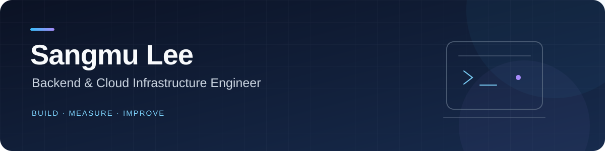

 

  
  
  

**信頼性 · パフォーマンス · リソース効率**

韓国・ソウル

  <a href="./README.md">ENG</a> &nbsp;|&nbsp;
  <a href="./README.ko.md">KOR</a> &nbsp;|&nbsp;
  <a href="./README.ja.md"><strong>JPN</strong></a>

## 👋 自己紹介

**信頼性、パフォーマンス、リソース効率**を重視して、バックエンドシステムとクラウドインフラを開発しています。問題の根本原因を追究し、計測によって変更の効果を確かめ、技術的な意思決定を文書に残すことを大切にしています。

---

## 🛠️ 技術スタック

**クラウド・インフラ**

  
  
  
  
  
  
  

**バックエンド**

  
  
  
  
  
  

**DevOps・オブザーバビリティ**

  
  
  
  

**データベース・メッセージング**

  
  
  
  
  

**フロントエンド・モバイル**

  
  
  
  
  
  
  
  

---

## 🚀 主要プロジェクト

### 🦉 [Sova](https://github.com/orgs/Softbank-Hackathon-Finals/repositories) · クラウド出口戦略・セキュリティガバナンス

**Python · Kubernetes · PostgreSQL · React · Ed25519**

チームのクラウド出口戦略基盤・共通セキュリティパッケージ・独立した統合試験環境・移行デモアプリにわたり、セキュリティガバナンス、移行先IaC、オブザーバビリティ、バックアップ・復元、監査ログ収集、Web運用ツールを開発しました。

- **成果:** 単一のオンプレミスKubernetesクラスタ上の専用ステートレス試験アプリで、**HTTP 403による拒否 → 独立した監査記録との照合 → 承認後の元ワークロードの隔離 → Greenの起動・HTTP応答 → 試験経路の切り替え**を確認しました。

<strong>技術的な詳細</strong>

- 検証根拠を正確なリソース範囲・ポリシーリビジョン・成果物ダイジェストに結び付け、**Ed25519検証**、独立したセキュリティ保留、明示的な承認ゲートを実装しました。
- PostgreSQLの操作・実行効果台帳に承認済みの実行を記録し、外部操作を繰り返さずにコミット済みの結果を復元します。結果が不確かな場合は、復旧のための確認対象に回す設計にしました。
- 再利用可能な **sova-security** パッケージを切り出し、観測済みの結果・承認・未検証の状態を区別するReactワークロードマップを開発しました。

**リポジトリ別の担当・貢献**

| リポジトリ | 担当 | 貢献内容 |
| --- | --- | --- |
| [platform](https://github.com/Softbank-Hackathon-Finals/platform) | セキュリティ・インフラ・運用 | セキュリティアーキテクチャ、統制・readinessゲート、脆弱性・検知統合、Security Review、移行元・移行先の監査ログ収集を設計・実装しました。移行先IaC API・GitOps（**T44**、初期構築の**T45**担当者と連携）、SHIFT/WATCH契約・OpenTelemetry収集（**T36/T37**）、CNPGバックアップ・復元（**T35**）、Web運用コンソール（**T21**）を担当し、マージ自動化（**T40/T41**、後に運用終了）にも貢献しました。 |
| [sova-test](https://github.com/Softbank-Hackathon-Finals/sova-test) | 独立プロトタイプ・統合試験環境 | 制御プレーンのプロトタイプ、Reactワークロードマップ・ライブコマンドコンソール、操作・実行効果台帳、承認に基づく隔離・復旧フローを実装しました。ローカルRKE2・EKS→RKE2の試験実行系、障害注入、署名付き根拠、監査証跡の保管も開発しました。チームの製品とは別の独立した検証環境です。 |
| [security](https://github.com/Softbank-Hackathon-Finals/security) | 共通セキュリティパッケージ・判定サービス | **sova-security**を切り出し、保護水準の比較、入力・根拠の署名検証、セキュリティ保留と別途承認による解除、OPA/Prowler/Trivy連携、テナント範囲に限定したPostgreSQLアダプター、任意のSecurity Reviewサービスとプラットフォーム側の利用契約を実装しました。 |
| [demo-app](https://github.com/Softbank-Hackathon-Finals/demo-app) | 移行対象ワークロード・参加者UI | **T4/T22**デモチャットのFastAPI HTTP/WebSocket API、PostgreSQLの冪等処理、S3添付、カットオーバー時の書き込み停止、OpenTelemetry計装を実装しました。モバイルメッセンジャー・模擬ウォレット/ポイント送金、再接続・再試行、実際のPostgreSQLを使うブラウザー回帰試験を開発しました。送金はシミュレーションであり、実際の決済ではありません。 |

### ⚡ [FaaS Platform](https://github.com/sangmu1126/FaaS-Platform) · 独自サーバーレス実行基盤

**AWS · EC2 · SQS · Docker · Redis · Terraform · Linux Cgroup v2**

ハッカソンのプロジェクトを個人で再設計し、ユーザーがアップロードした関数をDockerコンテナ内で実行するAWSベースのプラットフォームに発展させました。

- **成果:** `t3.micro` Worker 1台に毎秒3リクエストの負荷を60秒間投入し、**同期関数呼び出し181/181件**を完了しました。別途、Controllerのリクエスト受け付け試験では、プライベートHTTP経路で **毎秒445.57件の受け付け**を計測しました。

<strong>技術的な詳細</strong>

- **Controller → SQS → Worker** によってリクエストの受け付けと関数実行を分離し、Redis Pub/Subで同期応答を返す構成にしました。
- 再利用可能なコンテナのウォームプールと、プロセスの後始末・実行スロット管理・ユーザーコードの隔離のための保護機構を実装しました。
- TerraformとPackerでインフラを構築し、SQSの滞留量に基づくWorker Auto Scalingを設定しました。

### 🔎 [PipeLens](https://github.com/sangmu1126/PipeLens) · 根拠に基づくCI障害診断

**FastAPI · PostgreSQL · Redis · GitHub App · OpenAI · Prometheus**

失敗したGitHub Actionsのログをコード変更・ワークフロー設定と照合し、根拠を確認できる診断を提案するGitHub Appを開発しました。

- **成果:** 単一のDockerホスト上で4つのWorkerを使用した1時間の合成継続負荷試験で、**3,605件のジョブを消失・重複完了なしで処理**しました。

<strong>技術的な詳細</strong>

- ルールベースの分析と任意のLLM診断を組み合わせ、結果の公開前に根拠の引用とファイル単位の提案を検査しました。
- Webhook検証、信頼できないフォークの隔離、機密情報のマスキング、冪等性を備えたGitHubへの結果報告を実装しました。
- Redis Workerのリース・ハートビート・**フェンシングトークン**と、DB・キューの状態照合を利用して障害復旧を設計しました。

### ☸️ [KubeFit](https://github.com/sangmu1126/Kubefit) · Kubernetesリソース最適化

**Kubernetes · Prometheus · AWS EKS · Helm · k6 · Python · GitOps**

Kubernetesワークロードを分析してCPU・メモリ設定を提案し、変更を検証したうえで、人がレビューするためのGitHub Draft PRを作成するツールを開発しました。

- **成果:** **60分間のEKSパイロット試験で100,503リクエスト・HTTPエラー0件**を記録し、メトリクス収集と読み取り専用のリソース推奨フローを検証しました。

<strong>技術的な詳細</strong>

- Deployment・Podの識別情報をメトリクスと対応付け、**CPU P95**・**メモリP99** に安全マージンを加えて推奨値を算出しました。
- 一定の負荷で基準設定と候補設定を比較し、CPUスロットリングの根拠を加えることで、性能値だけによる誤った合格判定を防ぎました。
- 変更を自動マージ・デプロイせず、人の承認を経る構成にしました。

---

## 🧩 その他のプロジェクト

| プロジェクト | 主な内容 |
| --- | --- |
| [Sky](https://github.com/sangmu1126/sky-platform) | 対応するDocker・Linux VM・AWS環境向けに、アプリ分析・デプロイ計画・HTTP検証と更新・ロールバックのフローを実装しました。主要な経路には実環境でのデプロイ記録があり、ホスティング環境の自動化ループ全体は開発中です。 |
| [Safe Trade Plugin](https://github.com/sangmu1126/stock-helper-ai-plugin) | 取引時間・信用取引ルールの検査、境界テスト生成、ローカル価格アラートを提供するCodexプラグインです。**ローカルテスト372件が合格**し、JUnit環境が必要な4件はスキップしました。公開コードの検査には固定コミットとSHA-256検証を使用します。 |
| [Deplight](https://github.com/sangmu1126/Deplight) | GitHub Actions・Terraformを利用するECS Fargateデプロイ基盤です。実環境でのアプリのデプロイ・復旧、ALBルーティングの修正、アプリ別の状態分離、共有IAMロールの削除防止を記録しました。 |
| [EveryTown](https://github.com/sangmu1126/EveryTown) | Spring Boot・Elasticsearchを使用した位置情報検索基盤です。過去のローカル計測では、検索応答時間を約 **2秒から200ms** に短縮しました。 |
| [Mingle](https://github.com/sangmu1126/MingleGDSC) | Flutter・Firebaseを使用した教育アプリです。**Google Solution Challenge 2024 Global Top 100** に選出されました。 |
| [ElectricKo! / NewJeanse](https://github.com/sangmu1126/NewJeanse) | 5人のAIエネルギー管理プロジェクトを率い、予測モデルとバックエンドAPIの開発を担当しました。 |
| [PacketRoute](https://github.com/sangmu1126/PacketRoute) | OSPF/EIGRPの再配布、HSRPゲートウェイのフェイルオーバー、VLAN分離、ACLアクセス制御を扱うCisco Packet Tracerネットワークシミュレーションです。 |

---

## 💼 経験・活動

| 期間 | 活動 |
| --- | --- |
| **2026年10月 – 11月** | **SoftBank Hackathon 2026** — 予選ではAIを活用したAWSインフラのプロビジョニング・最適化基盤を開発し、決勝ではAWSからオンプレミスへの移行基盤のセキュリティ・オブザーバビリティ開発に参加しました。 |
| **2026年8月** | **Open Source Developer Contest 2026** — AWS EKSで検証したKubernetesリソース最適化ツールKubeFitを出品しました。 |
| **2026年6月 – 7月** | **AX Talent War 2026** — KakaoPay Securitiesの課題で投資支援プラグインを開発しました。 |
| **2025年11月 – 12月** | **SoftBank Hackathon 2025 in Korea** — 予選ではWebアプリのデプロイ基盤を、決勝ではAWSサーバーレス関数実行基盤を開発しました。 |
| **2025年9月 – 2026年4月** | **Soldesk** — AWSベースのCloud DevOps研修課程を修了しました。 |
| **2024年3月 – 11月** | **K-Software Empowerment Bootcamp（KEB）第3期** — 産学連携のソフトウェア開発研修課程を修了しました。 |
| **2023年8月 – 2024年8月** | **Google Developer Student Clubs（GDSC）** — 大学の開発者コミュニティで活動しました。 |
| **2021年9月 – 2025年8月** | **Kaiwa（大学の日本語・日本文化サークル）** — 2022年度前期に副会長、後期に会長を務めました。 |
| **2020年9月 – 2023年8月** | **IGRUS** — 大学のIT・ソフトウェア開発・セキュリティサークルで活動しました。 |

---

## 🏆 受賞歴

- **2025年12月** — **SoftBank Hackathon 2025 in Korea 予選優秀賞**、決勝進出。
- **2024年4月** — **Google Solution Challenge 2024 Global Top 100** 選出（Mingle）。

---

## 🎓 学歴・資格

- **仁荷大学** — コンピュータサイエンス・工学 学士（2020年3月 – 2025年8月）
- **TOPCIT レベル3** — 2024年5月

---

**丁寧に計測し、障害を想定して設計する。**  
*根拠で裏付けられることを記録する。*

