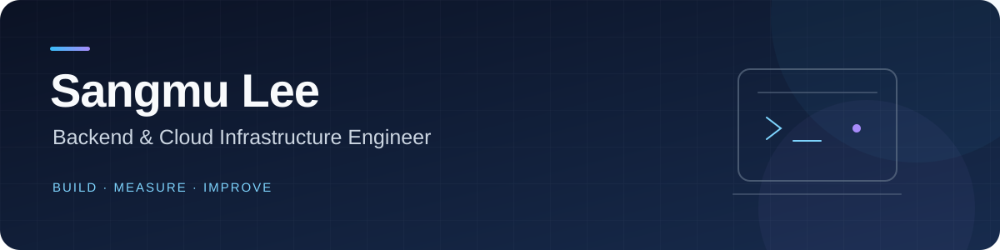

 

  
  
  

**안정성 · 성능 · 자원 효율**

대한민국 서울

  <a href="./README.md">ENG</a> &nbsp;|&nbsp;
  <a href="./README.ko.md"><strong>KOR</strong></a> &nbsp;|&nbsp;
  <a href="./README.ja.md">JPN</a>

## 👋 소개

**안정성, 성능, 자원 효율**을 중심으로 백엔드 시스템과 클라우드 인프라를 만듭니다. 문제의 근본 원인을 추적하고, 측정으로 변경 효과를 확인하며, 기술적 의사결정을 문서로 남기는 일을 좋아합니다.

---

## 🛠️ 기술 스택

**클라우드·인프라**

  
  
  
  
  
  
  

**백엔드**

  
  
  
  
  
  

**DevOps·관측성**

  
  
  
  
  

**데이터베이스·메시징**

  
  
  
  
  

**프론트엔드·모바일**

  
  
  
  
  
  
  
  

---

## 🚀 대표 프로젝트

### [Sova](https://github.com/orgs/Softbank-Hackathon-Finals/repositories) · 클라우드 출구전략·보안 거버넌스

**Python · Kubernetes · PostgreSQL · React · OpenTelemetry · Ed25519**

팀의 클라우드 출구전략 플랫폼·공통 보안 패키지·독립 통합 시험 환경·이전 데모 앱에 걸쳐 보안 거버넌스, 목적지 IaC, 관측, 백업·복원, 감사 로그 수집과 웹 운영 도구를 개발했습니다.

- **성과:** 단일 온프렘 Kubernetes 클러스터의 전용 무상태 시험 앱에서 **HTTP 403 차단 → 독립 감사 기록 대조 → 승인 후 원본 격리 → Green 기동·HTTP 응답 → 시험 경로 전환**을 확인했습니다.

<strong>기술 상세</strong>

- 근거를 정확한 자원 범위·정책 리비전·산출물 다이제스트에 결합하고, **Ed25519 검증**, 독립적인 보안 보류, 명시적 승인 게이트를 구현했습니다.
- PostgreSQL 작업·효과 원장에 승인된 실행을 기록하고, 외부 효과를 반복하지 않고 커밋된 결과를 복구하며, 결과가 불확실하면 복구 검토로 넘기도록 했습니다.
- 재사용 가능한 **sova-security** 패키지를 추출하고, 실제 관측·승인·미확인 상태를 구분하는 React 워크로드 지도를 만들었습니다.

**저장소별 기여·역할**

| 저장소 | 역할 | 기여 내용 |
| --- | --- | --- |
| [platform](https://github.com/Softbank-Hackathon-Finals/platform) | 보안·인프라·운영 | 보안 아키텍처, 통제·readiness 게이트, 취약점·탐지 통합, Security Review, 출발지·목적지 감사 로그 수집을 설계·구현했습니다. 목적지 IaC API·GitOps(**T44**, **T45** 최초 구축 담당자와 연계), SHIFT/WATCH 계약·OpenTelemetry 수집(**T36/T37**), CNPG 백업·복원(**T35**), 웹 운영 콘솔(**T21**)을 담당했습니다. 병합 자동화(**T40/T41**, 이후 사용 종료)에도 기여했습니다. |
| [sova-test](https://github.com/Softbank-Hackathon-Finals/sova-test) | 독립 프로토타입·통합 시험 환경 | 제어면 프로토타입, React 워크로드 지도·실시간 명령 콘솔, 작업·효과 원장, 승인 기반 격리·복구 흐름을 구현했습니다. 로컬 RKE2·EKS→RKE2 시험 실행기, 장애 주입, 서명 근거, 감사 증거 보존을 개발했습니다. 팀 제품과 구분되는 독립 검증 환경입니다. |
| [security](https://github.com/Softbank-Hackathon-Finals/security) | 공통 보안 패키지·판정 서비스 | **sova-security**를 분리하고, 보호 수준 비교, 입력·근거 서명 검증, 보안 보류·별도 승인 해제, OPA/Prowler/Trivy 연동, 테넌트 범위 PostgreSQL 어댑터, 선택형 Security Review 서비스와 플랫폼 소비 계약을 구현했습니다. |
| [demo-app](https://github.com/Softbank-Hackathon-Finals/demo-app) | 이전 대상 워크로드·참여자 UI | **T4/T22** 데모 채팅 앱의 FastAPI HTTP/WebSocket API, PostgreSQL 멱등 처리, S3 첨부, 컷오버 쓰기 차단, OpenTelemetry HTTP 지연 히스토그램·OTLP 전송을 구현했습니다. 모바일 메신저·모의 지갑/포인트 송금, 재접속·재시도, 실제 PostgreSQL을 사용하는 브라우저 회귀 시험을 개발했습니다. 지갑 송금은 실제 결제가 아닌 시뮬레이션입니다. |

**개인 개발:** [개인 저장소](https://github.com/sangmu1126/sova-test)에서 Sova를 재설계하고 추가 개발을 진행하고 있습니다.

### [FaaS Platform](https://github.com/sangmu1126/FaaS-Platform) · 자체 서버리스 실행 플랫폼

**AWS · EC2 · SQS · Docker · Redis · Terraform · Linux Cgroup v2**

해커톤 프로젝트를 개인적으로 재설계해, 사용자가 업로드한 함수를 Docker 컨테이너 안에서 실행하는 AWS 기반 플랫폼으로 확장했습니다.

- **성과:** `t3.micro` Worker 1대에 3 RPS의 요청 부하를 60초간 가해 **동기 함수 호출 181/181건**을 완료했습니다. 별도의 Controller 요청 접수 시험에서는 비공개 HTTP 경로에서 **초당 요청 수락 445.57건**을 측정했습니다.

<strong>기술 상세</strong>

- **Controller → SQS → Worker**로 요청 접수와 함수 실행을 분리하고, Redis Pub/Sub으로 동기 응답을 전달했습니다.
- 재사용 가능한 컨테이너 웜 풀과 프로세스 정리·실행 슬롯 관리·사용자 코드 격리를 위한 보호 장치를 구현했습니다.
- Terraform과 Packer로 인프라를 구성하고, SQS 대기열 적체량에 따른 Worker Auto Scaling을 설정했습니다.

### [PipeLens](https://github.com/sangmu1126/PipeLens) · 근거 기반 CI 실패 진단

**FastAPI · PostgreSQL · Redis · GitHub App · OpenAI · Prometheus**

실패한 GitHub Actions 로그를 코드 변경·워크플로 설정과 연결해, 근거를 확인할 수 있는 진단을 제안하는 GitHub App을 개발했습니다.

- **성과:** 단일 Docker 호스트에서 Worker 4개로 1시간 합성 지속 부하 시험을 수행해 **작업 3,605건을 유실·중복 완료 없이 처리**했습니다.

<strong>기술 상세</strong>

- 규칙 기반 분석과 선택적 LLM 진단을 결합하고, 결과 게시 전에 근거 인용과 파일별 제안을 검사했습니다.
- 웹훅 검증, 신뢰하지 않는 포크의 격리, 민감정보 마스킹, 멱등성을 갖춘 GitHub 결과 보고를 구현했습니다.
- Redis Worker 임대·하트비트·**펜싱 토큰**과 DB·큐 상태 대조를 이용해 장애 복구를 설계했습니다.

### [KubeFit](https://github.com/sangmu1126/Kubefit) · Kubernetes 자원 최적화

**Kubernetes · Prometheus · AWS EKS · Helm · k6 · Python · GitOps**

Kubernetes 워크로드를 분석하고 CPU·메모리 설정을 제안하며, 변경 검증 후 사람이 검토할 GitHub Draft PR을 만드는 도구를 개발했습니다.

- **성과:** **60분 EKS 파일럿에서 요청 100,503건·HTTP 오류 0건**을 기록하며 지표 수집과 읽기 전용 자원 권고 흐름을 검증했습니다.

<strong>기술 상세</strong>

- Deployment·Pod 식별 정보를 지표와 연결하고, **CPU P95**·**메모리 P99**에 안전 여유를 더해 권고값을 산출했습니다.
- 고정 부하에서 기준 설정과 후보 설정을 비교하고, CPU 스로틀링 근거를 추가해 성능 수치만으로 잘못 통과시키는 것을 방지했습니다.
- 자동 머지·배포 대신 사람의 승인을 거치도록 했습니다.

---

## 🧩 기타 프로젝트

| 프로젝트 | 주요 내용 |
| --- | --- |
| [Sky](https://github.com/sangmu1126/sky-platform) | 지원하는 Docker·Linux VM·AWS 대상의 앱 분석·배포 계획·HTTP 검증과 업데이트·롤백 흐름을 구현했습니다. 핵심 경로의 실제 배포 기록이 있으며, 호스팅 환경의 전체 자동화 루프는 개발 중입니다. |
| [Safe Trade Plugin](https://github.com/sangmu1126/stock-helper-ai-plugin) | 거래시간·신용 규칙 점검, 경계 테스트 생성, 로컬 가격 알림을 제공하는 Codex 플러그인입니다. **로컬 테스트 372개 통과**, JUnit 환경이 필요한 4개는 건너뛰었습니다. 공개 코드 검사는 고정 커밋과 SHA-256 검증을 사용합니다. |
| [Deplight](https://github.com/sangmu1126/Deplight) | GitHub Actions·Terraform을 사용하는 ECS Fargate 배포 플랫폼입니다. 실제 앱 배포·복구, ALB 라우팅 수정, 앱별 상태 격리, 공유 IAM 역할 삭제 방지 기록을 남겼습니다. |
| [EveryTown](https://github.com/sangmu1126/EveryTown) | Spring Boot·Elasticsearch 기반 위치 검색 플랫폼입니다. 과거 로컬 측정에서 검색 응답 시간을 약 **2초에서 200ms**로 줄였습니다. |
| [Mingle](https://github.com/sangmu1126/MingleGDSC) | Flutter·Firebase 기반 교육 앱으로, **Google Solution Challenge 2024 Global Top 100**에 선정됐습니다. |
| [ElectricKo! / NewJeanse](https://github.com/sangmu1126/NewJeanse) | 5명으로 구성된 AI 에너지 관리 프로젝트를 이끌며 예측 모델과 백엔드 API 개발을 담당했습니다. |
| [PacketRoute](https://github.com/sangmu1126/PacketRoute) | OSPF/EIGRP 재분배, HSRP 게이트웨이 장애 전환, VLAN 분리, ACL 접근 제어를 다룬 Cisco Packet Tracer 네트워크 시뮬레이션입니다. |

---

## 💼 경험·활동

| 기간 | 활동 |
| --- | --- |
| **2026.10 – 2026.11** | **SoftBank Hackathon 2026** — 예선에서 AI 기반 AWS 인프라 프로비저닝·최적화 플랫폼을 개발하고, 본선에서 AWS→온프렘 이전 플랫폼의 보안·관측성 개발에 참여했습니다. |
| **2026.08** | **공개SW 개발자대회 2026** — AWS EKS에서 검증한 Kubernetes 자원 최적화 도구 KubeFit을 출품했습니다. |
| **2026.06 – 2026.07** | **AX 인재전쟁 2026** — 카카오페이증권 과제에서 투자 지원 플러그인을 개발했습니다. |
| **2025.11 – 2025.12** | **SoftBank Hackathon 2025 in Korea** — 예선에서 웹앱 배포 플랫폼을, 본선에서 AWS 서버리스 함수 실행 플랫폼을 개발했습니다. |
| **2025.09 – 2026.04** | **솔데스크** — AWS 기반 Cloud DevOps 교육 과정을 수료했습니다. |
| **2024.03 – 2024.11** | **K-Software Empowerment Bootcamp(KEB) 3기** — 산학 연계 소프트웨어 개발 교육 과정을 수료했습니다. |
| **2023.08 – 2024.08** | **Google Developer Student Clubs(GDSC)** — 대학 개발자 커뮤니티에서 활동했습니다. |
| **2021.09 – 2025.08** | **카이와, 대학 일본어·일본문화 동아리** — 2022년 1학기 부회장, 2학기 회장으로 활동했습니다. |
| **2020.09 – 2023.08** | **IGRUS** — 대학 IT·소프트웨어 개발·보안 동아리에서 활동했습니다. |

---

## 🏆 수상

- **2025.11** — **SoftBank Hackathon 2025 in Korea 예선 우수상**, 본선 진출.
- **2024.04** — **Google Solution Challenge 2024 Global Top 100** 선정(Mingle).

---

## 🎓 학력·자격

- **인하대학교** — 컴퓨터공학 학사(2020.03 – 2025.08)
- **TOPCIT 수준 3** — 2024.05

---

**신중하게 측정하고, 장애를 고려해 설계합니다.**  
*근거로 뒷받침할 수 있는 내용을 기록합니다.*

