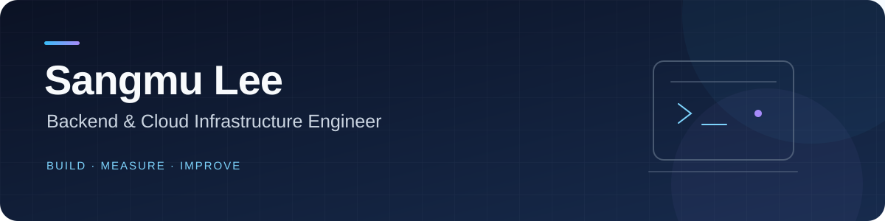

 

  
  
  

**Reliability · Performance · Resource Efficiency**

Seoul, South Korea

  <a href="./README.md"><strong>ENG</strong></a> &nbsp;|&nbsp;
  <a href="./README.ko.md">KOR</a> &nbsp;|&nbsp;
  <a href="./README.ja.md">JPN</a>

## 👋 About Me

I build backend systems and cloud infrastructure with a focus on **reliability, performance, and resource efficiency**. I enjoy tracing problems to their root causes, validating changes through measurements, and documenting engineering decisions.

---

## 🛠️ Tech Stack

**Cloud & Infrastructure**

  
  
  
  
  
  
  

**Backend**

  
  
  
  
  
  

**DevOps & Observability**

  
  
  
  

**Databases & Messaging**

  
  
  
  
  

**Frontend & Mobile**

  
  
  
  
  
  
  
  

---

## 🚀 Featured Projects

### 🦉 [Sova](https://github.com/orgs/Softbank-Hackathon-Finals/repositories) · Cloud Exit Platform & Security Governance

**Python · Kubernetes · PostgreSQL · React · Ed25519**

Contributed across the team's cloud-exit platform, reusable security package, independent integration testbed, and migration demo workload, covering security governance, destination IaC, observability, backup/restore, audit collection, and web operations tooling.

- **Results:** Validated **HTTP 403 enforcement → independent audit correlation → approved source isolation → Green startup and HTTP response → test-route switching** using a dedicated stateless app in a single on-premises Kubernetes cluster.

<strong>Engineering details</strong>

- Bound evidence to exact resource scope, policy revision, and artifact digests; implemented **Ed25519 verification**, independent security holds, and explicit approval gates.
- Used PostgreSQL operation and effect ledgers to record approved execution, recover committed results without repeating effects, and route uncertain outcomes to recovery review.
- Extracted the reusable **sova-security** package and built a React workload map that distinguishes observed results, approvals, and unverified states.

**My contributions by repository**

| Repository | Role | Contribution |
| --- | --- | --- |
| [platform](https://github.com/Softbank-Hackathon-Finals/platform) | Security, infrastructure & operations | Security architecture, control/readiness gates, vulnerability and detection integration, Security Review, and source/target audit collection. Destination IaC APIs and GitOps (**T44**, coordinated with the **T45** bootstrap owner); SHIFT/WATCH contracts and OpenTelemetry collection (**T36/T37**); CNPG backup/restore (**T35**); the web operations console (**T21**). Contributed merge automation (**T40/T41**, subsequently retired). |
| [sova-test](https://github.com/Softbank-Hackathon-Finals/sova-test) | Independent prototype & integration testbed | Built the control-plane prototype, React workload map and live command console, operation/effect ledgers, and approval-gated containment and recovery flows. Implemented local RKE2 and EKS-to-RKE2 test runners, fault injection, signed evidence, and audit evidence retention. This is an independent qualification environment, separate from the team's product. |
| [security](https://github.com/Softbank-Hackathon-Finals/security) | Reusable security package & review service | Extracted **sova-security**; implemented protection-parity checks, signed input/evidence verification, security holds and separately approved releases, OPA/Prowler/Trivy integrations, tenant-scoped PostgreSQL adapters, and the optional Security Review service and platform-consumer contracts. |
| [demo-app](https://github.com/Softbank-Hackathon-Finals/demo-app) | Migration workload & participant UI | Built the **T4/T22** demo chat workload: FastAPI HTTP/WebSocket APIs, PostgreSQL idempotency, S3 attachments, cutover write blocking, and OpenTelemetry instrumentation. Developed the mobile messenger, simulated wallet/point transfers, reconnect/retry handling, and PostgreSQL-backed browser regression tests. Wallet transfers are simulated, not real payments. |

**Ongoing personal development:** Redesigning and extending Sova in my [personal repository](https://github.com/sangmu1126/sova-test).

### ⚡ [FaaS Platform](https://github.com/sangmu1126/FaaS-Platform) · Custom Serverless Execution Platform

**AWS · EC2 · SQS · Docker · Redis · Terraform · Linux Cgroup v2**

Independently redesigned a hackathon project into an AWS-based platform for running user-uploaded functions inside Docker containers.

- **Results:** Completed **181/181 synchronous function invocations** at 3 offered RPS over 60 seconds on one `t3.micro` Worker. A separate Controller request-admission test measured **445.57 accepted requests/s** on its private HTTP path.

<strong>Engineering details</strong>

- Separated request handling from function execution with **Controller → SQS → Worker**, using Redis Pub/Sub for synchronous responses.
- Built reusable container warm pools and safeguards for process cleanup, execution-slot management, and user-code isolation.
- Provisioned the infrastructure with Terraform and Packer, and configured SQS backlog-based Worker Auto Scaling.

### 🔎 [PipeLens](https://github.com/sangmu1126/PipeLens) · Evidence-Based CI Failure Diagnosis

**FastAPI · PostgreSQL · Redis · GitHub App · OpenAI · Prometheus**

Developed a GitHub App that correlates failed GitHub Actions logs with code changes and workflow configuration to suggest verifiable diagnoses.

- **Results:** Completed **3,605 jobs** with **zero lost jobs or duplicate completions** in a one-hour, four-worker synthetic soak test on a single Docker host.

<strong>Engineering details</strong>

- Combined rule-based analysis with optional LLM diagnosis; checked evidence citations and file-level suggestions before publishing results.
- Implemented webhook verification, untrusted-fork isolation, sensitive-data redaction, and idempotent GitHub reporting.
- Designed failure recovery using Redis worker leases, heartbeats, **fencing tokens**, and database/queue reconciliation.

### ☸️ [KubeFit](https://github.com/sangmu1126/Kubefit) · Kubernetes Resource Optimization

**Kubernetes · Prometheus · AWS EKS · Helm · k6 · Python · GitOps**

Built a tool to analyze Kubernetes workloads, recommend CPU and memory resource settings, validate changes, and open GitHub Draft PRs for human review.

- **Results:** Validated metric collection and read-only resource recommendations in a **60-minute EKS pilot covering 100,503 requests with zero HTTP errors**.

<strong>Engineering details</strong>

- Correlated Deployment and Pod identities with metrics; derived recommendations from **CPU P95** and **memory P99** with safety margins.
- Compared baseline and candidate settings under fixed load and added CPU-throttling evidence to prevent misleading performance-only PASS decisions.
- Preserved human approval rather than automatically merging or deploying changes.

---

## 🧩 Other Projects

| Project | Highlights |
| --- | --- |
| [Sky](https://github.com/sangmu1126/sky-platform) | Application analysis, deployment planning, and HTTP verification across supported Docker, Linux VM, and AWS targets, with update and rollback workflows. Core paths have live deployment records; the full hosted automation loop remains under development. |
| [Safe Trade Plugin](https://github.com/sangmu1126/stock-helper-ai-plugin) | Codex plugin for market-hours and margin-rule checks, boundary-test generation, and local price alerts. **372 tests passed locally**, with 4 JUnit-dependent tests skipped; public-source checks use pinned commits and SHA-256 verification. |
| [Deplight](https://github.com/sangmu1126/Deplight) | ECS Fargate deployment platform using GitHub Actions and Terraform. Documented live application deployment and recovery, ALB routing fixes, per-app state isolation, and guards against shared IAM role deletion. |
| [EveryTown](https://github.com/sangmu1126/EveryTown) | Spring Boot and Elasticsearch location-based search platform. Reduced query latency from approximately **2 s to 200 ms** in historical local measurements. |
| [Mingle](https://github.com/sangmu1126/MingleGDSC) | Flutter and Firebase educational application; selected for the **Google Solution Challenge 2024 Global Top 100**. |
| [ElectricKo! / NewJeanse](https://github.com/sangmu1126/NewJeanse) | Led a five-member AI energy management project; worked on predictive modeling and backend APIs. |
| [PacketRoute](https://github.com/sangmu1126/PacketRoute) | Cisco Packet Tracer network simulation covering OSPF/EIGRP redistribution, HSRP gateway failover, VLAN segmentation, and ACL-based access control. |

---

## 💼 Experience & Activities

| Period | Activity |
| --- | --- |
| **Oct – Nov 2026** | **SoftBank Hackathon 2026** — Developed an AI-assisted AWS infrastructure provisioning and optimization platform in the preliminary round; contributed to security and observability for an AWS-to-on-premises migration platform in the final round. |
| **Aug 2026** | **Open Source Developer Contest 2026** — Submitted KubeFit, a Kubernetes resource optimization tool validated on AWS EKS. |
| **Jun – Jul 2026** | **AX Talent War 2026** — Built an investment-assistance plugin for a KakaoPay Securities challenge. |
| **Nov – Dec 2025** | **SoftBank Hackathon 2025 in Korea** — Developed a web-app deployment platform in the preliminary round and an AWS serverless function execution platform in the final round. |
| **Sep 2025 – Apr 2026** | **Soldesk** — Completed an AWS-based Cloud DevOps training program. |
| **Mar – Nov 2024** | **K-Software Empowerment Bootcamp (KEB), Cohort 3** — Completed a university–industry software development training program. |
| **Aug 2023 – Aug 2024** | **Google Developer Student Clubs (GDSC)** — Participated in a university developer community. |
| **Sep 2021 – Aug 2025** | **Kaiwa, university Japanese language & culture club** — Served as Vice President in the first semester of 2022 and President in the second semester. |
| **Sep 2020 – Aug 2023** | **IGRUS** — Participated in a university IT, software development, and security club. |

---

## 🏆 Honors & Awards

- **Dec 2025** — **Preliminary Round Excellence Award**, SoftBank Hackathon 2025 in Korea (advanced to the finals).
- **Apr 2024** — **Global Top 100**, Google Solution Challenge 2024 (Mingle).

---

## 🎓 Education & Qualifications

- **Inha University** — B.S., Computer Science and Engineering (Mar 2020 – Aug 2025)
- **TOPCIT Level 3** — May 2024

---

**Measure carefully. Design for failure.**  
*Document what the evidence supports.*

